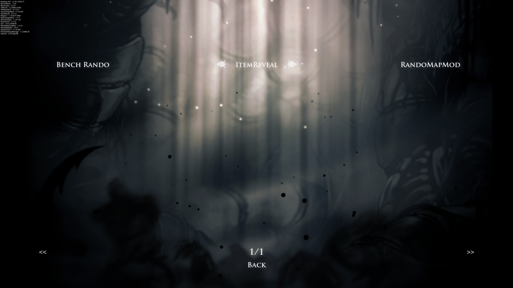
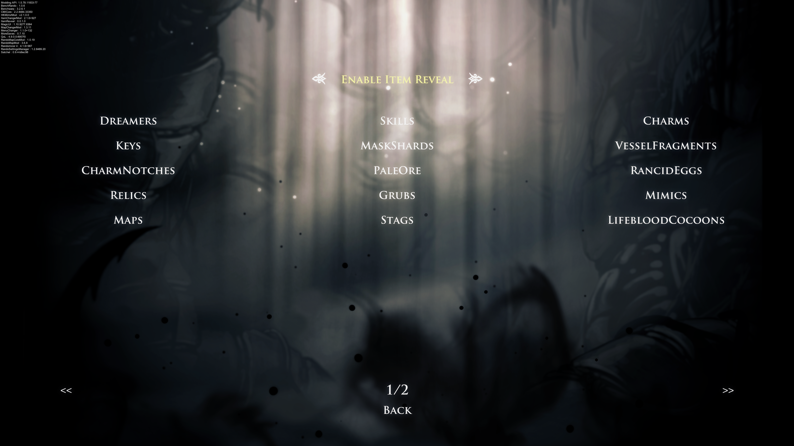
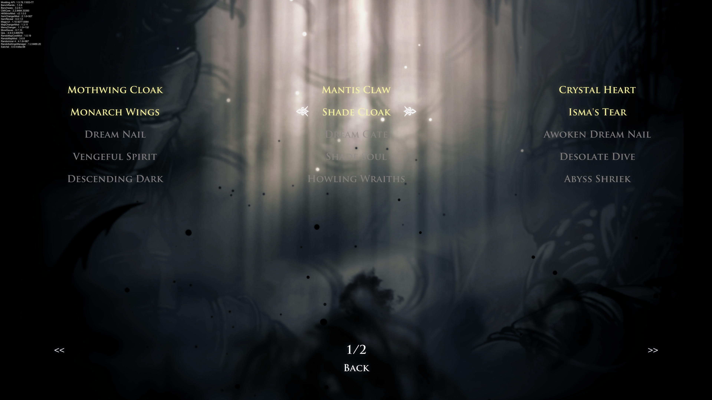
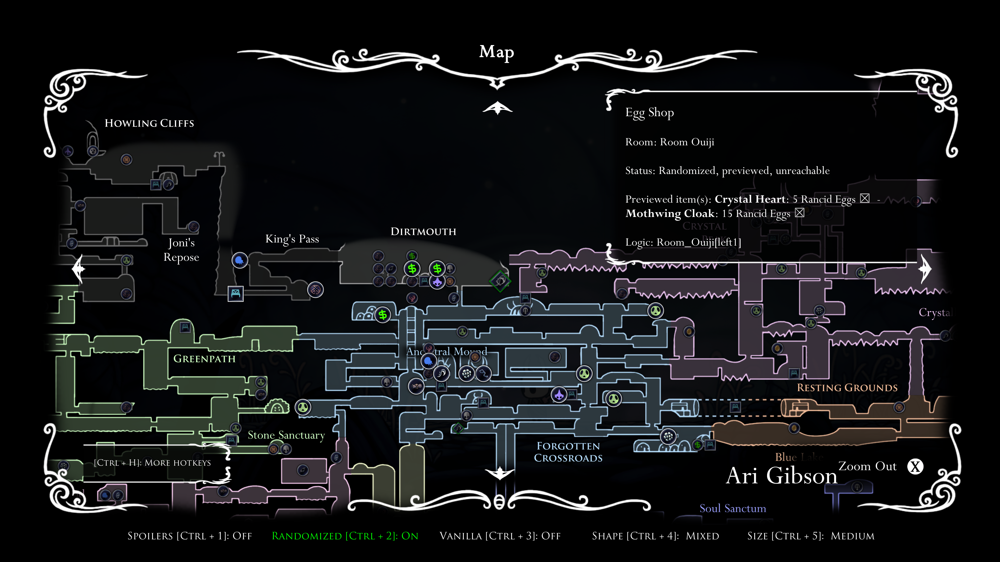
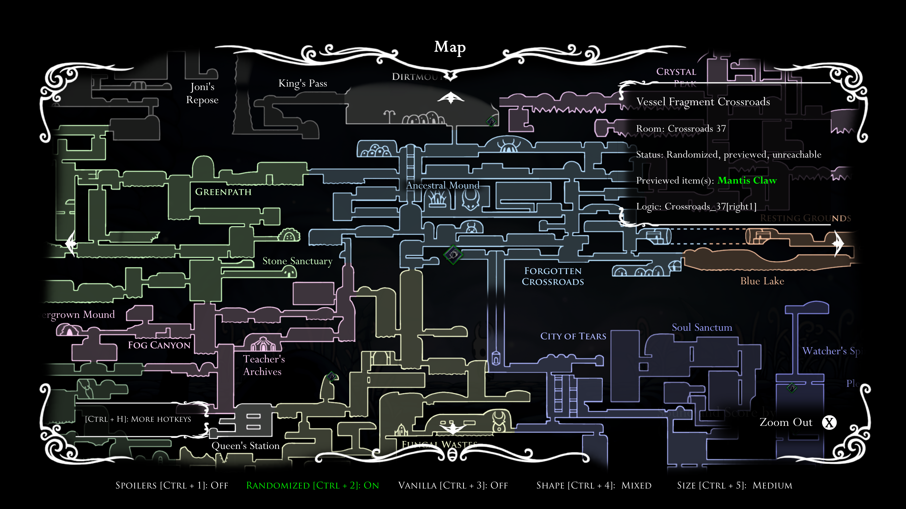

# ItemReveal

A Hollow Knight mod that allows you to reveal the location of specific items on the map at the start of a randomizer 4 save.

I designed this primarily to reduce variance in bingo races (randomly finding mantis claw first is a game breaking advantage), but it can also be used to make randomizer 4 more accessible for new players or just easier in general.

## Dependencies

Randomizer 4, RandomizerCore, ItemChanger, MenuChanger, RandoMapMod, RandoMapCore, RandoSettingsManager

## Usage

This mod adds a new button to the connections menu in Randomizer 4. Clicking the "ItemReveal" button opens a menu with the global toggle for the mod, as well as buttons for each major item pool.

Navigating through these pages you can toggle on any items you want to reveal at the start of a randomizer 4 save. The mod will then automatically reveal the locations of those items on the map when you start a new game.

Inside game, after activating RandoMapMod in the pause menu (Ctrl-M), you can open the map and see the revealed locations highlighted in a green diamond.

By holding the jump button for 0.3 seconds, you can filter the map to only show the revealed item pins to make them easier to find. Holding jump for an additional 0.3 seconds removes the filter.

Tapping the jump button will cycle through panning to each revealed item pin.

